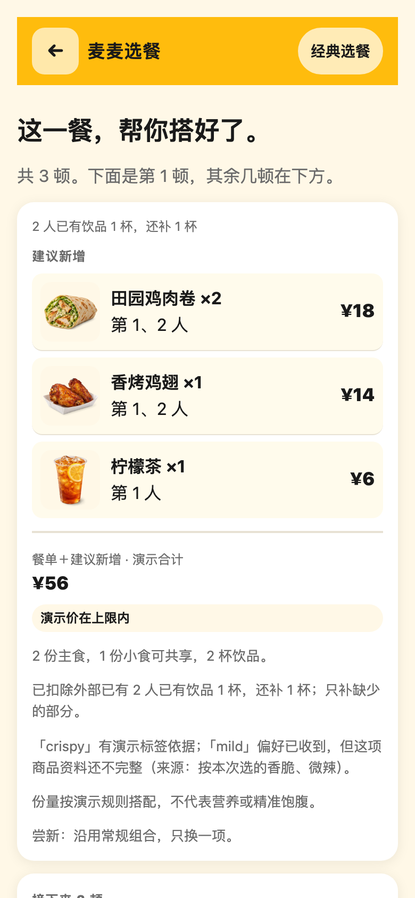
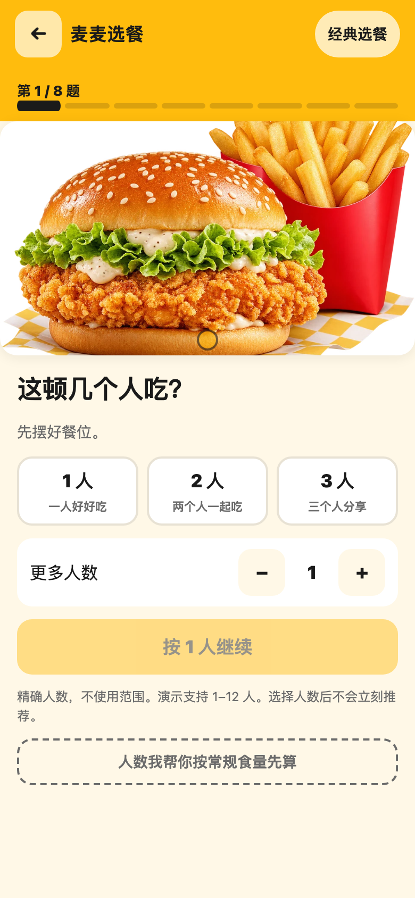
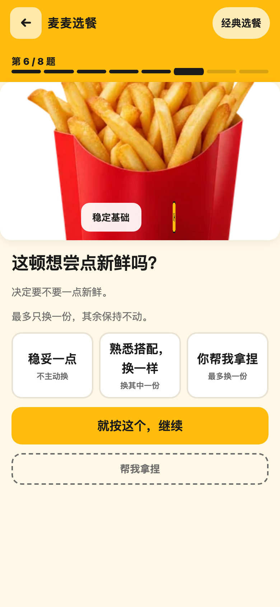
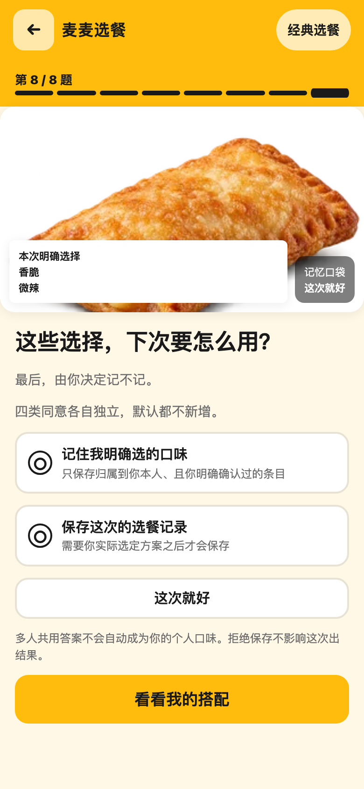
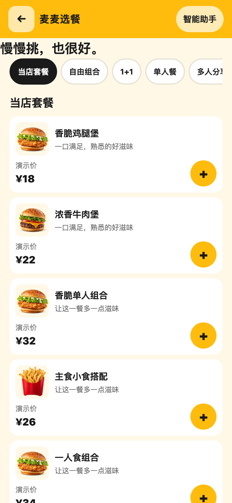
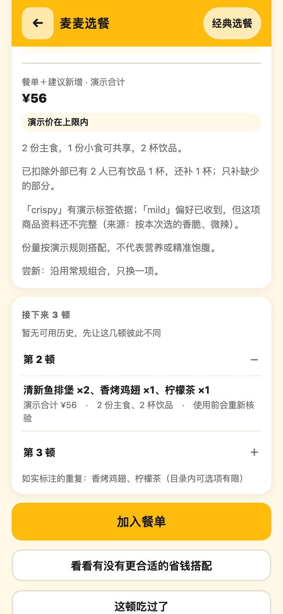
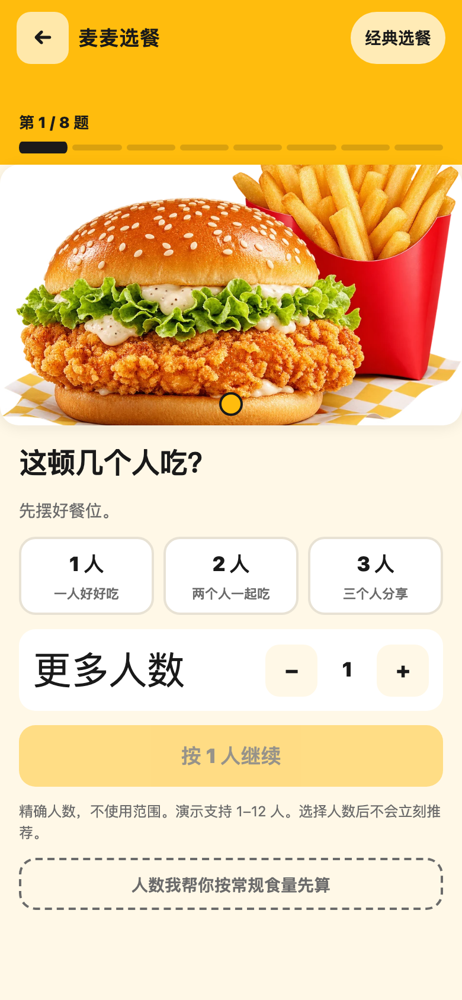

# 更懂你的麦麦选餐助手

仓库地址：https://github.com/MacApex/maimai-meal-assistant

<p align="center">



</p>
<p align="center"><sub>左：打开即用的首页　中：第三题先问清"你已经有什么"　右：推荐结果只补缺口、每条理由都写在页面上</sub></p>

## 项目介绍

点餐这件事，很少有人是被"菜单上有什么"难住的——菜单 App 早就够用了。

真正让人卡住的是另外几句心里话：

> "我都买好咖啡了，你还给我推饮品。"
> "四个人吃饭，一个不吃辣，最后要么全桌迁就，要么各点各的。"
> "我只是想换个小食，点了一下'换一换'，整行都被换掉了。"
> "昨天刚吃过，今天又推给我。"
> "人均还是整餐？两个人到底该点几份？预算到底够不够？"

这些抱怨听起来各不相同，其实都是同一件事：**它不知道你已经决定过什么**，于是把你已经解决的部分，又当成问题重新解决了一遍。

这个助手反过来做——**先把你已经定下来的事问清楚，然后只补真正缺的那部分**。

它会问你八个问题：几个人吃、预算按人均还是整餐算、你已经有什么、今天想吃点什么感觉、两个方向选哪个、要不要换换口味、只搭这一顿还是排上几天、要不要记住你的偏好。
它们不是八张只换文案的页面——每一题都真的会改变后面的算法结果；八题答完才给你整餐，中途绝不提前推销。

## 六个让人省心的地方

| 你遇到的情况 | 它是怎么做的 | 常见的笨办法 |
|---|---|---|
| 说了"想吃点清爽的" | 只按商品**真实标明**的属性来找。资料里没写的属性，它会老实说"你的偏好我收到了，但这项商品资料还不完整"，然后照常出结果 | 把"清爽""不油腻"当关键词硬搜，搜不到也假装匹配上了 |
| 让你在两个方向里挑 | 两个方向都给当下**真买得到**的东西；只有一个方向可行时，就直说只有一个，不硬凑第二个选项 | 为了凑成"二选一"，随手编一个不存在的方向 |
| 点了"换一换" | 最多只替你换**其中一份**，你锁住的、你已经熟悉的那些，一个都不动。没有官方新品依据时只说"换一款"，绝不冒充新品 | 一点"换一换"整行重来，连你特意留下的那份也一起换掉 |
| 担心被偷偷记住 | 四类记忆**各自独立开关**：用不用旧口味、参不参考上次选餐、存不存这次口味、存不存这次选餐。你全部拒绝，它也照样好好出结果。饭后反馈只有你主动说"吃过了"才问，加购物袋、下单都不算 | 默认全记住，也不告诉你记了什么 |
| 想把几天的饭一起排了 | 先让主食别连着重复，再让整餐别重复；来源写清楚是"选餐记录，不是订单"；候选不够时**明白告诉你哪一顿会重样** | 嘴上说五天不重样，实际上只是把顺序打乱 |
| 已经有一杯咖啡了 | 2 个人、已有 1 杯，就只补 1 杯；咖啡和其他饮品只抵扣一次，不会重复算。精确到钱：1 人 34 元的餐单改成 2 人、外面已有 1 份主食、预算 40 元时，它只补一杯 6 元的茶，主食按 2 人覆盖而不是凑成 3 份 | 按人数照推，你手里那杯咖啡等于白买了 |

上面这些不是形容词，每一条都能在测试里跑一遍对照（`TEST_REPORT.md` 里写清了编号、输入、预期和实际结果）。
`SUBMISSION_STATEMENT.md` 里另外写明哪些说法**还没被验证过**——比如八步是否真的比随便推荐更合用，我们没有用户数据，就不编"满意度提升多少"。

## 一句话

菜单和推荐解决"有什么"，本项目解决**"你已经决定过什么"**——
把模糊的"今天吃点什么"，变成一餐能解释、能自己改、能回头的饭。

<p align="center">




</p>
<p align="center"><sub>八题逐问，每一题都真的会改变算法结果——不是八个页面换文案</sub></p>

---

## 安装方法

本项目**零依赖安装**：不需要 `npm install`，不需要构建，不需要联网拉取模型或数据。
克隆或下载后按下面三种方式之一运行即可。

### 方式一：单文件（推荐先试这个）

打开 `standalone/index.html` 即可，**双击就能用**。图片全部内联，无需联网、无需服务器、无需构建。

### 方式二：目录版（开发用）

```bash
cd app
# 任选一种静态服务
python3 -m http.server 8080
# 然后访问 http://localhost:8080
```

也可以直接用浏览器打开 `app/index.html`（`file://` 协议同样可用）。

### 方式三：Skill 命令行

```bash
cd skill
node scripts/run-meal.js demo       # 一次跑通八题并打印整餐
```

Skill 与网页**共用同一份领域逻辑**（`wizard-domain.js` / `meal-engine.js` / `domain.js`），不存在两套算法漂移。

### 运行测试（可选）

```bash
node tests/domain.test.cjs        # 领域逻辑 112 项
node tests/wizard.test.cjs       # 八步向导
node tests/browser-check.cjs     # 浏览器验收（需本机 Playwright）
```

---

## 使用示例

**示例一：只补缺口（最常见）**

2 人用餐，其中 1 人已经买了咖啡，预算 40 元。
八步依次回答：`2 人` → `40 元以内` → `已有 1 杯咖啡` → `想清爽一点` → `选热食` →
`想试个新的` → `只搭这顿` → `不保存`。
输出会**只补 1 杯饮品**，不会因为"人数 = 2"就再推两杯，也不会重复推荐咖啡。
主食份数按 2 人覆盖，不按 2 人 + 1 杯咖啡凑成 3 份。

**示例二：直接换单品（预算内）**

在推荐结果里点某一行右侧的「换一个」，会列出该门店**当前实际可售**的同类型商品。
选中后该行数量保持不变、报价标记为待重算；点「用官方接口算价」才显示金额。

**示例三：预算确实不够时**

1 人、预算 10 元。系统会明确说"预算内找不到可行组合（已试 N 种，均超预算）"，
并给出最低可行金额与调整入口——**不会**先按超预算的组合装作可行。

**示例四：门店已打烊**

搜索出的门店若当前不在营业时间，界面直接说明"该门店当前已打烊或不在营业时间"，
并引导换一家，而不是在后续步骤里报一个看不懂的错误码。

> 以上为演示目录下的示例输出。接入真实 MCP 后，商品、价格与供应状态均以官方接口当次返回为准，
> 本项目不缓存、不推断、不编造。

---

## 目标用户

| 谁会用到它 | 他当时的处境 | 他能从这里拿到什么 |
|---|---|---|
| **临时凑几个人吃饭的人** | 有预算，但没想好点什么 | 八问之后，一餐能解释、能自己改的答案 |
| **手上已经有吃喝的人** | 买了咖啡、带了菜、已经点了前菜 | 清清楚楚告诉你"还缺什么"，不把已有的再卖一遍 |
| **一桌口味凑不到一起的人** | 有人吃辣、有人不吃，谁也不想迁就 | 给全桌一个都能接受的交集，而不是各点各的 |
| **想把钱花明白的人** | 心里有个上限，怕点完才发现超了 | 预算从一开始就参与筛选，不是最后一刻才告诉你超支 |
| **想知道"这推荐靠不靠谱"的人** | 怀疑价格是不是真的、有没有货 | 价格和库存只来自官方接口，没返回的字段一律标"未知" |

**它不服务这一类人**：想要"全自动一键下单"的。本项目的边界就停在选餐和官方算价，不代替官方 App 完成交易。

---

## 典型场景

- 2–5 人临时吃饭，有预算但没想好点什么
- 已经买了咖啡或带了菜，想知道**还缺什么**而不是被再推销一遍
- 想连续几天不重样，但不想每天重新做决定
- 忌口或挑食的人混在一桌，需要照顾到个人

---

## 和官方 App 已有能力的分工

| 已有能力 | 本项目新增 |
|---|---|
| 查菜单、看图片 | 八道问题把模糊意图变成**可解释**的搭配，并说明每条理由 |
| 推荐套餐 | 只补**缺口**：已有咖啡不会被再推荐一杯 |
| 换一换 | 最多只换**一份**，其余锁定不动，且没有证据时不称"新品" |
| 收藏历史 | 四类**独立**的保存同意，拒绝保存照样出结果 |
| 单次推荐 | 3／5 顿轮换，**先减少主食连续重复**，候选不足时如实标出重复 |
| 活动页 | 省钱方案只比**完整应付成本**，费用未知就标"待核实"，不喊"最低价" |

**不下单、不领券、不支付**是刻意的边界——也避免在公开部署中暴露个人账号数据。

---

## 八步引导

人数 → 预算 → 已有吃喝 → 口味 → 二选一方向 → 尝新程度 → 本顿／多顿 → 记忆授权

- **第 8 题提交前不展示完整推荐**
- **"都可以／帮我决定"只回答当前题**，下一题照常出现
- 每页一个专属场景构图，不是同一张卡片换文字
- 随时可返回修改，答案保留；结果页有"返回修改答案"出口
- 首页保留两个入口：更大的"智能选餐助手"，和较小但显眼的"经典选餐"

<p align="center">



</p>
<p align="center"><sub>经典自主选餐入口　·　多顿轮换如实标注来源与重复　·　200% 缩放下布局不破</sub></p>

---

## 数据模式说明（重要）

本项目交付时包含两种模式，界面上**始终明确区分**：

**演示模式（默认，完全离线）**
目录、价格、成分与优惠全部是**虚构演示数据**，食品图是原创示意图，不是官方商品实拍。辣度与油腻感等属性刻意保留为"资料不完整"，用来验证产品在证据不足时是否诚实。

**官方只读模式**
已通过 MCP 协议握手与 `tools/list` 验证服务端能力，并对只读工具完成分类。菜单、券与报价的端到端链路见 [`MCP_INTEGRATION.md`](MCP_INTEGRATION.md) 中的逐项状态表——**未验证的项不会标成已接通**。

无论哪种模式，本项目都**不下单、不领券、不支付**。

---

## 省钱 Wizard 的诚实边界

- 只在**获准的真实连接**核验过券资格与完整应付成本后才比较方案
- 商品金额、配送费、餐具费、其他必付费用必须齐全；任何必要费用未知就标"待核实"，**不会用 0 补齐**
- 优惠资格不符、券过期、无法叠加、核价失败，都不计入优惠
- 文案只说"本次已核验的这些方案中较省"，**不承诺全网最低或全渠道最优**
- 不自动领券、不凑单、不购卡

---

## 测试与构建

唯一源在 `app/src/`，所有入口都由它生成。以下命令可在**任意干净目录**执行（本包已验证）：

```bash
cd app
node --test tests/*.test.cjs        # 领域与合同测试 160 项（含 MCP 只读、脱敏、同意边界）
node tests/browser-wizard.cjs       # 浏览器验收 21 项 + 截图
node tests/batch1-cart.cjs          # 餐单与金额合同 12 项
node --test tests/round2-regressions.test.cjs   # 金额/覆盖/规格/未知费用回归 16 项
node build-all.js --check           # 校验各入口与唯一源零漂移
node build-standalone.js            # 重新生成单 HTML
node build-all.js                   # 由 src/ 重新生成全部入口
```

**依赖**：浏览器类脚本需要 Playwright 与 Chromium。脚本会在运行时自动探测
（依次尝试环境变量 `PLAYWRIGHT_MODULE` / `CHROMIUM_PATH`、当前 `node_modules`、
npx 缓存、Playwright 下载目录），无需修改代码。
未安装时先执行 `npm i -D playwright && npx playwright install chromium`。

产物一致性：`build-all.js` 会输出每个入口的 SHA256 组合校验和；
`--check` 只比对不写入，有漂移时退出码为 1，可直接用于 CI。

实测结果见 [`TEST_REPORT.md`](TEST_REPORT.md)。
真实接入版的验收对照（逐缺陷证据、八步映射实现程度、真实调用/隔离模拟/未测矩阵）
见 [`realtime-mcp/证据/第四轮验收对照.md`](realtime-mcp/证据/第四轮验收对照.md)。

诚实边界：未解决项不藏在别处。已知限制写在下面一节，
**未验证的主张一律标注未验证**，不写成已完成。

---

## 已知限制

- 演示目录的辣度与油腻感属性不完整，这是**刻意保留**的，不是数据缺失
- 份量按粗略规则搭配（每人 1 主食、每 2 人 1 共享小食、每人 1 饮品），**不代表营养或精准饱腹**
- 轮换时若目录内可选项不足，会如实标出重复，不保证绝不重复
- 多顿轮换每顿使用前需要重新核验人数、价格与供应；本项目不安排定时任务
- 真实只读接入的「门店 → 菜单 → 详情/规格 → 官方算价」链路已在授权只读环境用少量受控请求端到端复验（证据见 `realtime-mcp/证据/第四轮/`）；券资格核验因官方未提供可用只读工具，状态标为 `unavailable`，**未标成已接通**
- 仅在 Chromium 上测试过；Safari／VoiceOver 与真机未覆盖

---

## 目录结构

```
app/                可运行的目录版（原生 JS／HTML／CSS，无构建步骤）
standalone/         单 HTML 文件，图片全部内联
skill/              SKILL.md 与命令行脚本
tests/              领域测试与浏览器验收脚本
screenshots/        实际加载后的截图
docs/               设计说明与验收对照
realtime-mcp/       真实 MCP 接入版（本机网关 + 网页 + 测试 + 证据）
```

### 两套代码的关系（请勿混淆）

| | `app/` `standalone/` `skill/` | `realtime-mcp/` |
|---|---|---|
| 数据来源 | **虚构演示目录** | **官方 MCP 接口** |
| 需要凭据 | 不需要 | 需要（`~/.workbuddy/mcp.json`） |
| 联网 | 不需要 | 需要 |
| 定位 | 评审可直接打开、离线可跑 | 真实接入的完整实现与证据 |

`realtime-mcp/` 是真实接入的实现，架构为 `浏览器 → 网关(127.0.0.1) → mcp.mcd.cn`。
Token 只存在于网关进程内存，浏览器拿不到；写操作路由**不存在**（返回 404）。
启动方式见 `realtime-mcp/start.sh`，完整复跑见 `realtime-mcp/run-all.sh`。

```bash
cd realtime-mcp
bash start.sh      # 启动网关与网页，访问 http://127.0.0.1:8796
bash run-all.sh    # 复跑全部测试，任一必需测试失败则返回非零退出码
```

**换机器运行**：`NODE` 可指定 Node 路径，缺省回落到 `PATH` 里的 `node`；
浏览器类脚本的 Playwright 模块与 Chromium 路径可用
`PLAYWRIGHT_MODULE` / `CHROMIUM_PATH` 环境变量覆盖，无需改代码。

## 安全与合规

- 配置文件只使用环境变量占位符，**不含任何真实 Token 或密钥**
- 单文件与网页版均不接收、不存储、不传输凭据
- `node secret-scan.js` 只扫描拟提交包，只报告路径与计数，不打印秘密本身
- 本项目为参赛作品，**非麦当劳官方产品**；输出仅供参考，不构成医疗或营养建议

## 素材来源

食品图为**原创演示示意**，非官方商品实拍，不含联名 IP 或授权标志。详见 [`ASSET_SOURCES.md`](ASSET_SOURCES.md)。